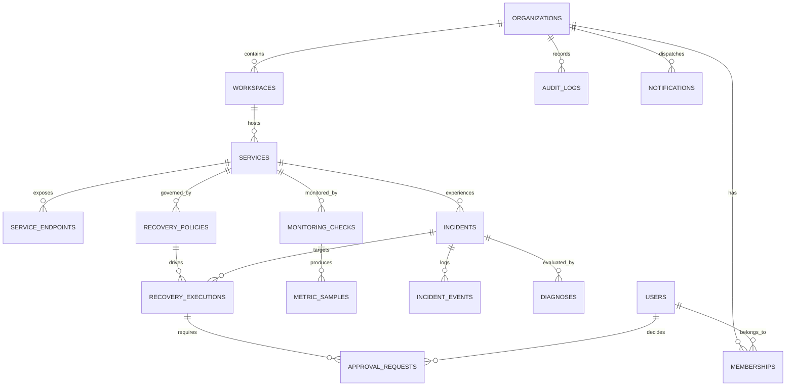

# Database Design & Schema Specification

| **Document Title** | HealCloud Relational Data Architecture (PostgreSQL) |
| :--- | :--- |
| **Document Version** | 2.0.0 (Master Plan Aligned) |
| **Status** | Approved |

---

## 1. Storage Architecture Overview

HealCloud utilizes **PostgreSQL 16** as its unified transactional and operational datastore:
- Enforces strict multi-tenant isolation via foreign key constraints (`organization_id`, `workspace_id`).
- Implements optimistic locking, timestamps, and indexing on all high-cardinality foreign keys.
- Utilizes **Redis 7** for ephemeral caching, distributed mutex locking, and task queue management.

---

## 2. Entity-Relationship Diagram (ERD)

---

## 3. Detailed Entity Definitions (16 Tables)

### 3.1 `organizations`
Top-level multi-tenant account boundary.
- `id` (UUID, PK)
- `name` (VARCHAR 255)
- `slug` (VARCHAR 100, UNIQUE)
- `is_active` (BOOLEAN)
- `created_at` (TIMESTAMPTZ)
- `updated_at` (TIMESTAMPTZ)

### 3.2 `workspaces`
Sub-environments within an organization (e.g., Production, Staging, QA).
- `id` (UUID, PK)
- `organization_id` (UUID, FK -> organizations.id ON DELETE CASCADE)
- `name` (VARCHAR 255)
- `slug` (VARCHAR 100)
- `description` (TEXT)
- `created_at` (TIMESTAMPTZ)
- `updated_at` (TIMESTAMPTZ)
- *Constraint:* UNIQUE (`organization_id`, `slug`)

### 3.3 `users`
Global platform user identities.
- `id` (UUID, PK)
- `email` (VARCHAR 255, UNIQUE)
- `password_hash` (VARCHAR 255)
- `full_name` (VARCHAR 255)
- `is_active` (BOOLEAN)
- `is_platform_admin` (BOOLEAN)
- `created_at` (TIMESTAMPTZ)
- `updated_at` (TIMESTAMPTZ)

### 3.4 `memberships`
Tenant-scoped role assignment linking users to organizations and workspaces.
- `id` (UUID, PK)
- `organization_id` (UUID, FK -> organizations.id ON DELETE CASCADE)
- `user_id` (UUID, FK -> users.id ON DELETE CASCADE)
- `role` (VARCHAR 50) — `ORG_OWNER`, `ORG_ADMIN`, `RELIABILITY_ENGINEER`, `VIEWER`
- `created_at` (TIMESTAMPTZ)
- *Constraint:* UNIQUE (`organization_id`, `user_id`)

### 3.5 `services`
Monitored software services and applications.
- `id` (UUID, PK)
- `organization_id` (UUID, FK -> organizations.id ON DELETE CASCADE)
- `workspace_id` (UUID, FK -> workspaces.id ON DELETE CASCADE)
- `name` (VARCHAR 255)
- `description` (TEXT)
- `health_status` (VARCHAR 50) — `HEALTHY`, `DEGRADED`, `UNHEALTHY`, `UNKNOWN`
- `created_at` (TIMESTAMPTZ)
- `updated_at` (TIMESTAMPTZ)
- *Constraint:* UNIQUE (`workspace_id`, `name`)

### 3.6 `service_endpoints`
Target network and HTTP endpoints for a service.
- `id` (UUID, PK)
- `service_id` (UUID, FK -> services.id ON DELETE CASCADE)
- `url` (VARCHAR 1024)
- `method` (VARCHAR 10, DEFAULT 'GET')
- `expected_status_code` (INT, DEFAULT 200)
- `timeout_ms` (INT, DEFAULT 5000)
- `headers` (JSONB)
- `created_at` (TIMESTAMPTZ)

### 3.7 `monitoring_checks`
Health check execution definitions.
- `id` (UUID, PK)
- `service_id` (UUID, FK -> services.id ON DELETE CASCADE)
- `endpoint_id` (UUID, FK -> service_endpoints.id ON DELETE CASCADE)
- `interval_seconds` (INT, DEFAULT 30)
- `consecutive_failure_threshold` (INT, DEFAULT 3)
- `is_enabled` (BOOLEAN, DEFAULT TRUE)
- `last_checked_at` (TIMESTAMPTZ)
- `created_at` (TIMESTAMPTZ)

### 3.8 `metric_samples`
Historical health check measurements.
- `id` (UUID, PK)
- `check_id` (UUID, FK -> monitoring_checks.id ON DELETE CASCADE)
- `service_id` (UUID, FK -> services.id ON DELETE CASCADE)
- `timestamp` (TIMESTAMPTZ NOT NULL)
- `status_code` (INT)
- `response_time_ms` (FLOAT)
- `is_successful` (BOOLEAN)
- `error_message` (TEXT)
- *Index:* (`service_id`, `timestamp` DESC)

### 3.9 `incidents`
Active and resolved reliability incidents.
- `id` (UUID, PK)
- `organization_id` (UUID, FK -> organizations.id ON DELETE CASCADE)
- `workspace_id` (UUID, FK -> workspaces.id ON DELETE CASCADE)
- `service_id` (UUID, FK -> services.id ON DELETE CASCADE)
- `incident_number` (VARCHAR 64, UNIQUE)
- `title` (VARCHAR 500)
- `severity` (VARCHAR 50) — `P1_CRITICAL`, `P2_HIGH`, `P3_MEDIUM`, `P4_LOW`
- `status` (VARCHAR 50) — `OPEN`, `INVESTIGATING`, `RECOVERY_PENDING`, `RECOVERING`, `RESOLVED`, `CLOSED`, `FAILED`
- `detected_at` (TIMESTAMPTZ NOT NULL)
- `resolved_at` (TIMESTAMPTZ)
- `created_at` (TIMESTAMPTZ)
- `updated_at` (TIMESTAMPTZ)

### 3.10 `incident_events`
Chronological event timeline for an incident.
- `id` (UUID, PK)
- `incident_id` (UUID, FK -> incidents.id ON DELETE CASCADE)
- `event_type` (VARCHAR 100) — `DETECTED`, `DIAGNOSED`, `APPROVAL_REQUESTED`, `RECOVERY_STARTED`, `VERIFIED`, `RESOLVED`
- `message` (TEXT)
- `payload` (JSONB)
- `created_at` (TIMESTAMPTZ)

### 3.11 `diagnoses`
Rule-matched diagnostic analysis for an incident.
- `id` (UUID, PK)
- `incident_id` (UUID, FK -> incidents.id ON DELETE CASCADE)
- `rule_name` (VARCHAR 255)
- `root_cause_hypothesis` (TEXT)
- `confidence_score` (FLOAT) — Between 0.0 and 1.0
- `evidence` (JSONB)
- `recommended_action` (VARCHAR 255)
- `created_at` (TIMESTAMPTZ)

### 3.12 `recovery_policies`
Governance rules binding detected issues to safe recovery actions.
- `id` (UUID, PK)
- `organization_id` (UUID, FK -> organizations.id ON DELETE CASCADE)
- `workspace_id` (UUID, FK -> workspaces.id ON DELETE CASCADE)
- `service_id` (UUID, FK -> services.id ON DELETE SET NULL)
- `name` (VARCHAR 255)
- `trigger_condition` (VARCHAR 255)
- `allowed_action` (VARCHAR 255) — Allowlisted simulator action (e.g. `SIMULATE_RESTART`, `SIMULATE_SCALE`, `SIMULATE_CIRCUIT_BREAK`)
- `requires_approval` (BOOLEAN, DEFAULT FALSE)
- `max_retries` (INT, DEFAULT 2)
- `cooldown_seconds` (INT, DEFAULT 300)
- `timeout_seconds` (INT, DEFAULT 60)
- `is_enabled` (BOOLEAN, DEFAULT TRUE)
- `created_at` (TIMESTAMPTZ)

### 3.13 `recovery_executions`
Execution logs of simulated or automated recovery runs.
- `id` (UUID, PK)
- `incident_id` (UUID, FK -> incidents.id ON DELETE CASCADE)
- `policy_id` (UUID, FK -> recovery_policies.id ON DELETE CASCADE)
- `status` (VARCHAR 50) — `QUEUED`, `RUNNING`, `VERIFYING`, `SUCCESS`, `FAILED`, `ROLLED_BACK`
- `action_taken` (VARCHAR 255)
- `execution_output` (TEXT)
- `duration_ms` (INT)
- `verification_passed` (BOOLEAN)
- `started_at` (TIMESTAMPTZ)
- `completed_at` (TIMESTAMPTZ)

### 3.14 `approval_requests`
Human-in-the-Loop decision ledger for sensitive actions.
- `id` (UUID, PK)
- `execution_id` (UUID, FK -> recovery_executions.id ON DELETE CASCADE)
- `requested_by_user_id` (UUID, FK -> users.id)
- `decided_by_user_id` (UUID, FK -> users.id)
- `decision` (VARCHAR 50) — `PENDING`, `APPROVED`, `REJECTED`, `EXPIRED`
- `reason` (TEXT)
- `decided_at` (TIMESTAMPTZ)
- `created_at` (TIMESTAMPTZ)

### 3.15 `audit_logs`
Tamper-evident append-only ledger of platform events.
- `id` (UUID, PK)
- `organization_id` (UUID, FK -> organizations.id ON DELETE CASCADE)
- `actor_id` (UUID)
- `actor_email` (VARCHAR 255)
- `action` (VARCHAR 100)
- `resource_type` (VARCHAR 100)
- `resource_id` (VARCHAR 255)
- `state_before` (JSONB)
- `state_after` (JSONB)
- `ip_address` (VARCHAR 45)
- `created_at` (TIMESTAMPTZ)
- *Index:* (`organization_id`, `created_at` DESC)

### 3.16 `notifications`
Dispatched alerts to operators and external channels.
- `id` (UUID, PK)
- `organization_id` (UUID, FK -> organizations.id ON DELETE CASCADE)
- `channel` (VARCHAR 50) — `IN_APP`, `EMAIL`, `WEBHOOK`, `SLACK`
- `title` (VARCHAR 255)
- `message` (TEXT)
- `status` (VARCHAR 50) — `PENDING`, `SENT`, `FAILED`
- `sent_at` (TIMESTAMPTZ)
- `created_at` (TIMESTAMPTZ)
