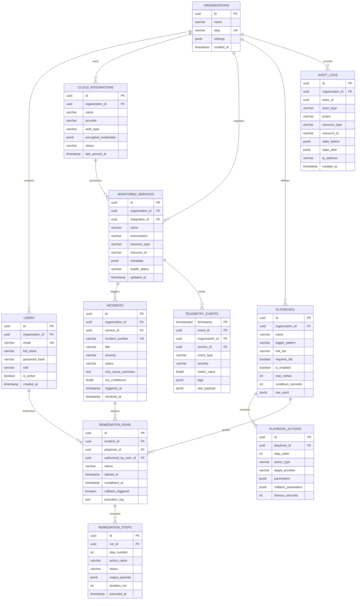

# Database Design & Schema Specification

| **Document Title** | HealCloud Relational & Time-Series Data Architecture |
| :--- | :--- |
| **Document Version** | 1.0.0 |
| **Status** | Approved |

---

## 1. Storage Strategy Overview

HealCloud leverages a hybrid storage model tailored for reliability, relational integrity, and high-velocity time-series telemetry:

1. **PostgreSQL 16 (Primary Datastore):** Enforces ACID guarantees, relational foreign key constraints, and JSONB document flexibility for multi-tenancy, user management, incident tracking, playbooks, and immutable audit logs.
2. **TimescaleDB Extension:** Turns PostgreSQL into a high-performance time-series engine for telemetry events and metric snapshots with automated chunk partitioning and hypertable data compression.
3. **Redis 7 (In-Memory Cache & Message Broker):** Handles pub/sub event distribution, distributed resource locking (`redlock`), session caching, and Celery task queuing.

---

## 2. Entity-Relationship Diagram (ERD)



---

## 3. Detailed Table Definitions

### 3.1 `organizations`
Multi-tenant container for all resources.
```sql
CREATE TABLE organizations (
    id UUID PRIMARY KEY DEFAULT gen_random_uuid(),
    name VARCHAR(255) NOT NULL,
    slug VARCHAR(100) UNIQUE NOT NULL,
    settings JSONB NOT NULL DEFAULT '{"max_concurrency": 5, "default_cooldown_sec": 300}',
    created_at TIMESTAMPTZ NOT NULL DEFAULT NOW(),
    updated_at TIMESTAMPTZ NOT NULL DEFAULT NOW()
);
```

### 3.2 `cloud_integrations`
Encrypted credentials and metadata for target cloud environments.
```sql
CREATE TABLE cloud_integrations (
    id UUID PRIMARY KEY DEFAULT gen_random_uuid(),
    organization_id UUID NOT NULL REFERENCES organizations(id) ON DELETE CASCADE,
    name VARCHAR(255) NOT NULL,
    provider VARCHAR(50) NOT NULL, -- 'kubernetes', 'aws', 'gcp', 'azure'
    auth_type VARCHAR(50) NOT NULL, -- 'kubeconfig', 'iam_role', 'service_account'
    encrypted_credentials BYTEA NOT NULL, -- AES-256-GCM encrypted secret payload
    key_id VARCHAR(100) NOT NULL, -- KMS Key Identifier used for envelope encryption
    status VARCHAR(50) NOT NULL DEFAULT 'active', -- 'active', 'degraded', 'unreachable'
    last_synced_at TIMESTAMPTZ,
    created_at TIMESTAMPTZ NOT NULL DEFAULT NOW()
);
CREATE INDEX idx_cloud_integrations_org ON cloud_integrations(organization_id);
```

### 3.3 `monitored_services`
Cloud and Kubernetes resources under HealCloud observation.
```sql
CREATE TABLE monitored_services (
    id UUID PRIMARY KEY DEFAULT gen_random_uuid(),
    organization_id UUID NOT NULL REFERENCES organizations(id) ON DELETE CASCADE,
    integration_id UUID NOT NULL REFERENCES cloud_integrations(id) ON DELETE CASCADE,
    name VARCHAR(255) NOT NULL,
    environment VARCHAR(50) NOT NULL DEFAULT 'production', -- 'production', 'staging'
    resource_type VARCHAR(100) NOT NULL, -- 'k8s_deployment', 'aws_asg', 'k8s_statefulset'
    resource_id VARCHAR(500) NOT NULL, -- 'default/deployments/payment-service'
    metadata JSONB NOT NULL DEFAULT '{}',
    health_status VARCHAR(50) NOT NULL DEFAULT 'HEALTHY', -- 'HEALTHY', 'DEGRADED', 'UNHEALTHY'
    created_at TIMESTAMPTZ NOT NULL DEFAULT NOW(),
    updated_at TIMESTAMPTZ NOT NULL DEFAULT NOW(),
    CONSTRAINT uq_org_resource UNIQUE (organization_id, integration_id, resource_id)
);
CREATE INDEX idx_monitored_services_org ON monitored_services(organization_id, health_status);
```

### 3.4 `telemetry_events` (TimescaleDB Hypertable)
High-volume time-series telemetry events, metrics, and alerts.
```sql
CREATE TABLE telemetry_events (
    timestamp TIMESTAMPTZ NOT NULL,
    event_id UUID NOT NULL DEFAULT gen_random_uuid(),
    organization_id UUID NOT NULL,
    service_id UUID REFERENCES monitored_services(id) ON DELETE SET NULL,
    event_type VARCHAR(100) NOT NULL, -- 'metric_anomaly', 'oom_kill', 'http_5xx_spike'
    severity VARCHAR(50) NOT NULL, -- 'CRITICAL', 'WARNING', 'INFO'
    metric_value DOUBLE PRECISION,
    tags JSONB NOT NULL DEFAULT '{}',
    raw_payload JSONB NOT NULL DEFAULT '{}',
    PRIMARY KEY (timestamp, event_id)
);

-- Convert into TimescaleDB Hypertable partitioned by 1-day intervals
SELECT create_hypertable('telemetry_events', 'timestamp', chunk_time_interval => INTERVAL '1 day');

CREATE INDEX idx_telemetry_org_time ON telemetry_events (organization_id, timestamp DESC);
CREATE INDEX idx_telemetry_service_time ON telemetry_events (service_id, timestamp DESC);
```

### 3.5 `incidents`
Tracked reliability incidents with diagnostic details.
```sql
CREATE TABLE incidents (
    id UUID PRIMARY KEY DEFAULT gen_random_uuid(),
    organization_id UUID NOT NULL REFERENCES organizations(id) ON DELETE CASCADE,
    service_id UUID NOT NULL REFERENCES monitored_services(id) ON DELETE CASCADE,
    incident_number VARCHAR(64) UNIQUE NOT NULL, -- e.g. 'INC-2026-0042'
    title VARCHAR(500) NOT NULL,
    severity VARCHAR(50) NOT NULL, -- 'P1_CRITICAL', 'P2_HIGH', 'P3_MEDIUM', 'P4_LOW'
    status VARCHAR(50) NOT NULL DEFAULT 'DETECTED', 
    -- 'DETECTED', 'DIAGNOSING', 'AWAITING_APPROVAL', 'REMEDIATING', 'VERIFYING', 'RESOLVED', 'FAILED'
    root_cause_summary TEXT,
    rca_confidence DOUBLE PRECISION DEFAULT 0.0,
    evidence JSONB NOT NULL DEFAULT '[]',
    triggered_at TIMESTAMPTZ NOT NULL DEFAULT NOW(),
    resolved_at TIMESTAMPTZ,
    created_at TIMESTAMPTZ NOT NULL DEFAULT NOW(),
    updated_at TIMESTAMPTZ NOT NULL DEFAULT NOW()
);
CREATE INDEX idx_incidents_org_status ON incidents(organization_id, status);
CREATE INDEX idx_incidents_service ON incidents(service_id);
```

### 3.6 `playbooks` & `playbook_actions`
Self-healing recipes defining remediation logic.
```sql
CREATE TABLE playbooks (
    id UUID PRIMARY KEY DEFAULT gen_random_uuid(),
    organization_id UUID NOT NULL REFERENCES organizations(id) ON DELETE CASCADE,
    name VARCHAR(255) NOT NULL,
    description TEXT,
    trigger_pattern VARCHAR(255) NOT NULL, -- regex or event_type match
    risk_tier VARCHAR(50) NOT NULL DEFAULT 'TIER_2', -- 'TIER_1_LOW', 'TIER_2_MEDIUM', 'TIER_3_HIGH'
    requires_hitl BOOLEAN NOT NULL DEFAULT FALSE,
    is_enabled BOOLEAN NOT NULL DEFAULT TRUE,
    max_retries INT NOT NULL DEFAULT 1,
    cooldown_seconds INT NOT NULL DEFAULT 300,
    raw_yaml TEXT NOT NULL,
    created_at TIMESTAMPTZ NOT NULL DEFAULT NOW(),
    updated_at TIMESTAMPTZ NOT NULL DEFAULT NOW()
);

CREATE TABLE playbook_actions (
    id UUID PRIMARY KEY DEFAULT gen_random_uuid(),
    playbook_id UUID NOT NULL REFERENCES playbooks(id) ON DELETE CASCADE,
    step_order INT NOT NULL,
    action_type VARCHAR(100) NOT NULL, -- 'k8s_restart_deployment', 'k8s_scale_replicas', 'aws_asg_bump'
    target_provider VARCHAR(50) NOT NULL,
    parameters JSONB NOT NULL DEFAULT '{}',
    rollback_parameters JSONB NOT NULL DEFAULT '{}',
    timeout_seconds INT NOT NULL DEFAULT 60,
    CONSTRAINT uq_playbook_step UNIQUE (playbook_id, step_order)
);
```

### 3.7 `remediation_runs` & `remediation_steps`
Execution telemetry for automated actions.
```sql
CREATE TABLE remediation_runs (
    id UUID PRIMARY KEY DEFAULT gen_random_uuid(),
    incident_id UUID NOT NULL REFERENCES incidents(id) ON DELETE CASCADE,
    playbook_id UUID NOT NULL REFERENCES playbooks(id) ON DELETE CASCADE,
    authorized_by_user_id UUID REFERENCES users(id) ON DELETE SET NULL,
    status VARCHAR(50) NOT NULL DEFAULT 'QUEUED',
    -- 'QUEUED', 'RUNNING', 'VERIFYING', 'SUCCESS', 'FAILED', 'ROLLED_BACK'
    started_at TIMESTAMPTZ,
    completed_at TIMESTAMPTZ,
    rollback_triggered BOOLEAN NOT NULL DEFAULT FALSE,
    execution_log TEXT,
    created_at TIMESTAMPTZ NOT NULL DEFAULT NOW()
);

CREATE TABLE remediation_steps (
    id UUID PRIMARY KEY DEFAULT gen_random_uuid(),
    run_id UUID NOT NULL REFERENCES remediation_runs(id) ON DELETE CASCADE,
    step_number INT NOT NULL,
    action_name VARCHAR(100) NOT NULL,
    status VARCHAR(50) NOT NULL, -- 'SUCCESS', 'FAILED', 'SKIPPED'
    output_payload JSONB NOT NULL DEFAULT '{}',
    duration_ms INT NOT NULL,
    executed_at TIMESTAMPTZ NOT NULL DEFAULT NOW()
);
```

### 3.8 `audit_logs`
Tamper-evident append-only ledger for all operational events.
```sql
CREATE TABLE audit_logs (
    id UUID PRIMARY KEY DEFAULT gen_random_uuid(),
    organization_id UUID NOT NULL REFERENCES organizations(id) ON DELETE CASCADE,
    actor_id UUID,
    actor_type VARCHAR(50) NOT NULL, -- 'SYSTEM_AGENT', 'USER', 'API_KEY'
    action VARCHAR(100) NOT NULL, -- 'REMEDIATION_TRIGGERED', 'PLAYBOOK_MODIFIED', 'APPROVAL_GRANTED'
    resource_type VARCHAR(100) NOT NULL,
    resource_id VARCHAR(255) NOT NULL,
    state_before JSONB,
    state_after JSONB,
    ip_address INET,
    created_at TIMESTAMPTZ NOT NULL DEFAULT NOW()
);
CREATE INDEX idx_audit_org_time ON audit_logs(organization_id, created_at DESC);
```

---

## 4. Partitioning & Data Retention

| Table | Retention Period | Strategy |
| :--- | :--- | :--- |
| `telemetry_events` | 30 days active / 90 days cold | TimescaleDB hypertable with automated 1-day chunking & zstd compression after 7 days |
| `remediation_steps` | 180 days | PostgreSQL native range partitioning by month |
| `audit_logs` | 7 years (Compliance requirement) | Immutable append-only with periodic cold S3 Glacier archiving |
