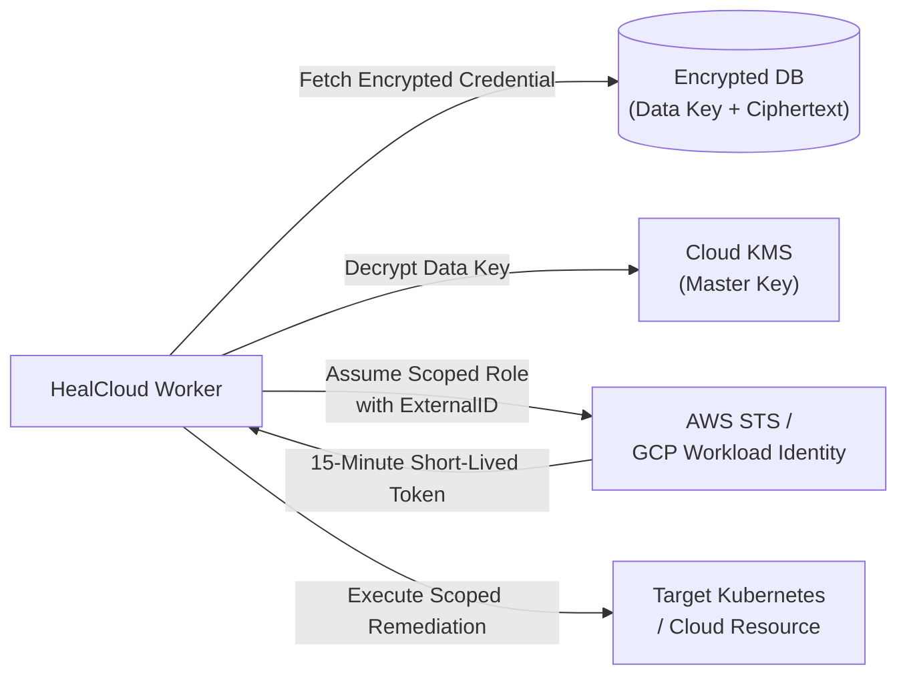

# Security Architecture & Safety Design

| **Document Title** | HealCloud Security, Blast Radius & Safety Guardrails |
| :--- | :--- |
| **Document Version** | 1.0.0 |
| **Status** | Approved |

---

## 1. Security Philosophy & Principles

Because HealCloud possesses write permissions to reboot instances, scale clusters, and roll back code in production environments, the platform is engineered under a **Zero-Trust, Fail-Safe** security model:

1. **Least Privilege by Design:** Agents and connectors are granted the absolute minimum IAM permissions required for their registered playbooks (e.g., `apps/v1` patch permission, never cluster-admin).
2. **Blast Radius Isolation:** Automated actions are bounded by concurrency ceilings, localized namespace boundaries, and automated circuit breakers.
3. **Dual-Custody for Destructive Ops:** High-risk actions (node termination, stateful volume unmounting, database failovers) strictly require Human-in-the-Loop (HITL) cryptographic approval.
4. **Non-Repudiation:** Every action, decision, and operator override is permanently committed to an immutable append-only audit trail.

---

## 2. STRIDE Threat Model & Mitigations

| Threat Category | Potential Attack Vector | HealCloud Architectural Mitigation |
| :--- | :--- | :--- |
| **Spoofing** | Adversary injects fake telemetry webhooks to trigger false remediations. | Webhook signatures verified via HMAC-SHA256 secret tokens; IP allowlisting; mutual TLS (mTLS) for Prometheus/OTel feeds. |
| **Tampering** | Malicious alteration of playbooks or database audit logs. | Playbooks versioned with cryptographic hashes; audit logs write-only with WORM (Write Once Read Many) AWS S3 Object Lock. |
| **Repudiation** | Operator denies granting approval for a disruptive cloud rollback. | Approval requires signed JWT credentials with IP, timestamp, and optional MFA challenge tied to the approval record. |
| **Information Disclosure** | Leakage of cloud credentials or cluster kubeconfigs stored in the DB. | Envelope encryption using AWS KMS / HashiCorp Vault; credentials decrypted strictly in-memory during task execution. |
| **Denial of Service** | Telemetry ingestion endpoint flooded to cause platform blindness. | Cloudflare DDoS protection; rate limiting per tenant; Redis Streams event backpressure buffers. |
| **Elevation of Privilege** | Compromised worker process escapes and accesses other customer cloud tenants. | Worker tasks executed in isolated sandboxes; tenant-isolated IAM assume roles with dynamic session tokens. |

---

## 3. Cloud IAM & Secrets Management



### 3.1 Credential Architecture
- **No Long-Lived Static Keys:** HealCloud never stores static AWS Access Keys or root passwords.
- **Cross-Account Role Delegation:** Uses AWS STS `AssumeRole` with a unique, cryptographically random `ExternalId` per customer organization to eliminate confused-deputy attacks.
- **Short-Lived Tokens:** Cloud sessions are restricted to a maximum time-to-live (TTL) of 15 minutes.
- **Envelope Encryption:** All stored integration metadata is encrypted using AES-256-GCM. The data encryption key (DEK) is itself encrypted under a customer-managed or platform-managed Master Key (KEK) via Cloud KMS.

---

## 4. Blast Radius & Guardrail Engine

To guarantee that self-healing automation cannot create cascading outages or flapping loops, the Guardrail Engine intercepts every playbook before scheduling:

```text
[Playbook Triggered]
         │
         ▼
[Check 1: Maintenance Window Active?] ────(Yes)────► [Suppress & Log]
         │ (No)
         ▼
[Check 2: Resource Cooldown Elapsed?] ───(No)─────► [Drop / Flapping Alert]
         │ (Yes)
         ▼
[Check 3: Tenant Concurrency Limit?] ────(Over)───► [Queue / Delay]
         │ (Within Limit)
         ▼
[Check 4: Risk Tier Evaluation]
    ├── Tier 1 (Low Risk)    ──► [Execute Immediately]
    ├── Tier 2 (Medium Risk) ──► [Evaluate Dynamic Circuit Breaker]
    └── Tier 3 (High Risk)   ──► [Require HITL Approval Gate]
```

### 4.1 Safety Thresholds & Parameters
- **Anti-Flapping Cooldown:** Minimum 300 seconds (5 minutes) before the same resource can undergo another remediation.
- **Cluster Concurrency Ceiling:** Maximum 2 simultaneous automated remediations per cluster.
- **Consecutive Failure Circuit Breaker:** If 2 consecutive remediation runs for a service fail, the service is locked in `MANUAL_ONLY` state and an urgent P1 page is issued.
- **Auto-Rollback Verification:** Every remediation must execute a health check probe (HTTP 200, pod ready condition) within 60 seconds; failure automatically executes the reverse rollback playbook.

---

## 5. Role-Based Access Control (RBAC) Matrix

| Permission / Action | Super Admin | SRE Lead / Operator | Platform Engineer | Security Auditor | Viewer |
| :--- | :---: | :---: | :---: | :---: | :---: |
| View Incidents & Telemetry | ✅ | ✅ | ✅ | ✅ | ✅ |
| Acknowledge Incidents | ✅ | ✅ | ✅ | ❌ | ❌ |
| Author & Edit Playbooks | ✅ | ✅ | ✅ | ❌ | ❌ |
| Approve Tier 1/2 Actions | ✅ | ✅ | ✅ | ❌ | ❌ |
| Approve Tier 3 (Destructive) | ✅ | ✅ | ❌ | ❌ | ❌ |
| Manage Cloud Integrations | ✅ | ❌ | ❌ | ❌ | ❌ |
| Export Immutable Audit Logs | ✅ | ✅ | ❌ | ✅ | ❌ |
| Manage User Roles & SSO | ✅ | ❌ | ❌ | ❌ | ❌ |

---

## 6. Audit Logging & Compliance Readiness

- **WORM Ledger (Write Once, Read Many):** Audit events are streamed to append-only storage with cryptographic hash chaining ($H_n = \text{SHA256}(H_{n-1} + \text{Event}_n)$) to detect any post-facto tampering.
- **Compliance Coverage:**
  - **SOC 2 Type II:** CC6.1 (Logical Access), CC6.8 (Unauthorized Changes Prevention), CC7.2 (Security Incident Monitoring).
  - **ISO/IEC 27001:2022:** Control A.8.15 (Logging), Control A.8.18 (Privileged Access Rights).
