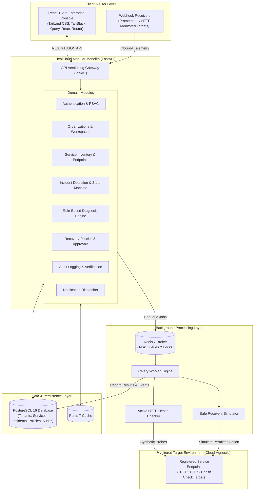
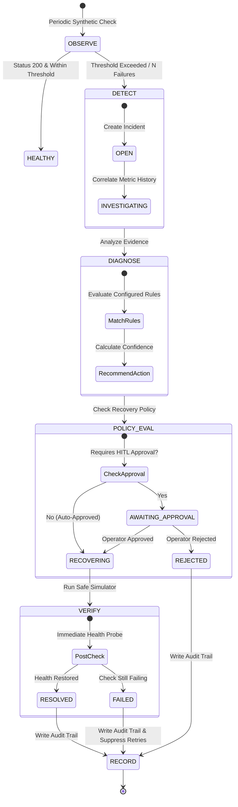

# System Architecture Specification

| **Document Title** | HealCloud Modular Monolith Architecture & Data Flow |
| :--- | :--- |
| **Document Version** | 2.0.0 (Master Plan Aligned) |
| **Status** | Approved |

---

## 1. High-Level Architectural Pattern

HealCloud is architected as a **Cloud-Agnostic Modular Monolith** with independently running background worker processes:

1. **Modular Monolith Core (FastAPI):** High-cohesion, loosely-coupled modules managing authentication, tenancy, inventory, policy, and API delivery within a single unified codebase.
2. **Background Worker Engine (Celery / Redis):** Asynchronously executes synthetic health checks, metric aggregation, incident rule evaluation, and recovery simulations.
3. **Primary Datastore (PostgreSQL 16):** Transactional datastore enforcing strict relational integrity, foreign key cascades, tenant segregation, and time-series metric tracking.
4. **Cache & Task Broker (Redis 7):** Ephemeral caching, rate-limiting counters, distributed mutex locks, and task queuing.
5. **Frontend SRE Console (React + Vite + TypeScript + Tailwind CSS):** Single Page Application (SPA) offering a premium enterprise dark-theme control room.



---

## 2. Core Domain Modules

```text
backend/app/
├── core/                 # App config, Pydantic settings, logging, security
├── db/                   # SQLAlchemy engine, session factory, base model
├── api/                  # Versioned API routes (/api/v1)
├── modules/
│   ├── auth/             # Registration, login, password hashing, JWT
│   ├── organizations/    # Organizations, memberships, workspaces
│   ├── services/         # Service inventory, endpoints, health configs
│   ├── monitoring/       # Health checks, metric samples, synthetic probes
│   ├── incidents/        # Incident lifecycle, event tracking, deduplication
│   ├── diagnosis/        # Explainable rule-based root cause analysis
│   ├── recovery/         # Recovery policies, approval workflows, execution
│   ├── simulator/        # Safe recovery simulator for test services
│   ├── verification/     # Post-recovery health verification
│   └── audit/            # Immutable audit logging
```

---

## 3. Product Workflow State Machine

$$\text{OBSERVE} \longrightarrow \text{DETECT} \longrightarrow \text{DIAGNOSE} \longrightarrow \text{POLICY / APPROVAL} \longrightarrow \text{RECOVER} \longrightarrow \text{VERIFY} \longrightarrow \text{RECORD}$$



---

## 4. Tenant Isolation Strategy

HealCloud enforces complete tenant isolation at the data access layer:
- Every tenant resource references `organization_id` (and optionally `workspace_id`).
- All repository queries filter explicitly by the authenticated user's active tenant:
  `SELECT * FROM services WHERE organization_id = :current_org_id AND workspace_id = :current_ws_id`.
- Cross-tenant access attempts immediately trigger a `403 Forbidden` error and write an audit security event.
