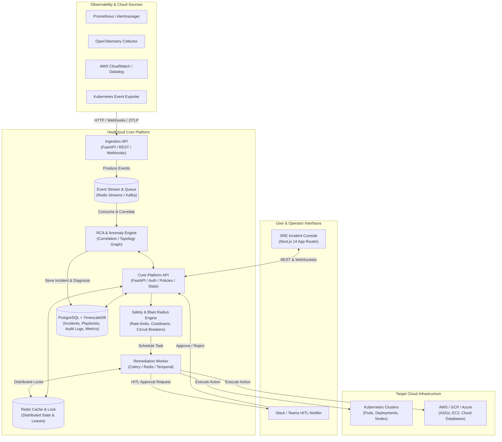
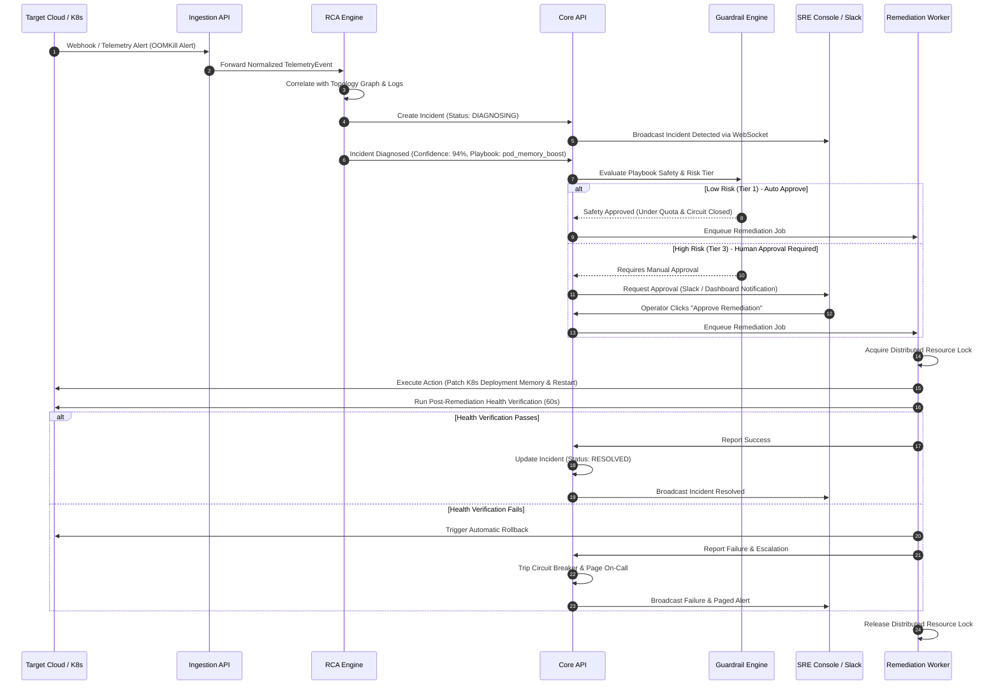

# System Architecture Specification

| **Document Title** | HealCloud Distributed Architecture & Data Flow |
| :--- | :--- |
| **Document Version** | 1.0.0 |
| **Status** | Approved |

---

## 1. High-Level Architecture Overview

HealCloud is structured as an event-driven, decoupled microservices platform. The system operates on a closed-loop observability and remediation lifecycle:
1. **Ingest:** Telemetry, logs, and alerts stream into high-throughput API endpoints.
2. **Correlate & Diagnose:** Telemetry is debounced and correlated against a real-time topology map to identify root causes.
3. **Decide:** The policy engine selects an appropriate playbook and evaluates safety guardrails (cooldowns, rate limits, blast radius).
4. **Remediate:** The asynchronous worker engine executes actions against cloud/Kubernetes APIs under optional Human-in-the-Loop (HITL) gates.
5. **Verify & Audit:** The system validates system health post-remediation, rolling back if unhealed, and commits an immutable audit record.

---

## 2. Component Deep-Dive

### 2.1 Telemetry Ingestion Layer (`backend/app/ingestion`)
- **FastAPI Ingestion Endpoints:** High-throughput, stateless endpoints running under ASGI (`uvicorn`) optimized for low-latency JSON and protobuf payloads.
- **Webhook Adapters:** Specialized adapters translating incoming webhook formats (Prometheus Alertmanager, Datadog v2, AWS SNS CloudWatch, PagerDuty) into standardized `TelemetryEvent` models.
- **Debounce Buffer:** Sliding window (30-second bucket) to group correlated alerts from flapping systems into a unified incident context.

### 2.2 Core API Service (`backend/app/api`)
- **Authentication & Multi-Tenancy:** JWT-based user authentication, API key validation (`hc_live_...`), and organization-level data segregation.
- **Incident State Machine:** Manages state transitions:
  `DETECTED` $\rightarrow$ `DIAGNOSING` $\rightarrow$ `AWAITING_APPROVAL` $\rightarrow$ `REMEDIATING` $\rightarrow$ `VERIFYING` $\rightarrow$ `RESOLVED` / `FAILED_ROLLED_BACK`.
- **Playbook Registry:** CRUD management, YAML schema validation, and version control for automated remediation playbooks.

### 2.3 Anomaly Correlation & RCA Engine (`backend/app/engine`)
- **Topology Graph Provider:** Maintains an in-memory graph of resource relationships (e.g., `Cluster` $\rightarrow$ `Namespace` $\rightarrow$ `Deployment` $\rightarrow$ `Pod` $\rightarrow$ `Node` $\rightarrow$ `VPC`).
- **Statistical Analyzers:** Exponentially Weighted Moving Average (EWMA) and dynamic thresholds to detect metric deviations across error rates, CPU/Memory saturation, and connection pools.
- **Diagnosis Generator:** Synthesizes anomalous signals, queries the topology graph for the bottleneck resource, and calculates confidence scores for probable root causes.

### 2.4 Remediation Worker Engine (`worker/`)
- **Asynchronous Task Queue:** Powered by Celery with Redis broker (with roadmap migration to Temporal for long-running workflows).
- **Execution Sandbox:** Every cloud action runs inside an isolated worker process with strict timeouts (default 60s per task).
- **Distributed Locking:** Uses Redis distributed locks (`redlock`) keyed on the target resource ID (e.g., `lock:k8s:pod:prod-checkout-service`) to prevent concurrent competing remediation actions.
- **Rollback Engine:** Each action plugin defines a corresponding reverse `rollback()` function executed automatically if post-remediation health probes fail.

### 2.5 Safety & Blast Radius Control (`backend/app/guardrails`)
- **Rate-Limiter:** Enforces quotas per resource (e.g., maximum 2 pod restarts per 10 minutes per deployment).
- **Circuit Breaker:** Automatically trips to open state if consecutive remediations fail or if cluster health worsens, freezing automated execution and paging on-call engineers.
- **Maintenance Windows:** Suppresses automated actions during scheduled deployment or maintenance windows.

### 2.6 Frontend SRE Console (`frontend/`)
- **Framework:** Next.js 14 (App Router) with React, Tailwind CSS, and TanStack Query.
- **Real-Time Updates:** WebSocket connection to `/api/v1/ws/incidents` delivering instant updates as state changes occur.
- **Interactive Visualizations:** Topology graph rendering, incident timeline scrubber, and visual playbook builder.

---

## 3. Incident Lifecycle & Remediation Sequence

---

## 4. Fault Tolerance & Self-Protection

1. **Dead-Man Switch:** If the HealCloud agent loses connectivity to target clusters or heartbeat expires, automated actions are suspended.
2. **Idempotent Operations:** All remediation actions are implemented to be strictly idempotent; re-running an action produces no unintended secondary side-effects.
3. **Database Write Resiliency:** Telemetry ingestion buffers incoming spikes in Redis Streams, decoupling ingestion throughput from database write limits.
